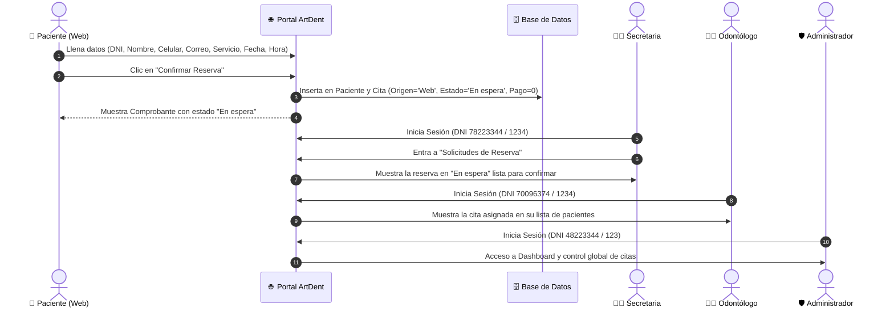

# Guía de Usuario y Documentación Funcional: RF01 - Reservación de Citas

---

## 1. Ficha del Requerimiento

| Campo | Detalle |
| :--- | :--- |
| **Identificador** | **RF01** |
| **Nombre del Requerimiento** | Reservación de citas |
| **Prioridad** | Alta |
| **Módulo** | Citas y Reservas Web / Atención al Paciente |
| **Cambio en APF2** | **Modificado:** El pago ya no forma parte del proceso de reserva (desacoplado y diferido al requerimiento RF10). La cita se registra directamente con estado **"En espera"** sin requerir transacción monetaria previa. |

---

## 2. Descripción en Lenguaje Sencillo

Este requerimiento permite que **cualquier persona (paciente nuevo o recurrente), sin necesidad de crear una cuenta ni iniciar sesión**, pueda reservar una cita dental desde el portal web de la clínica ArtDent.

El paciente ingresa sus datos básicos de contacto, escoge el servicio odontológico que necesita, la fecha, la hora y el médico especialista disponible. Al confirmar, el sistema genera de inmediato un **Comprobante de Reserva** con estado **"En espera"** y muestra el costo referencial del tratamiento. 

> [!NOTE]
> **¿Por qué ya no se cobra aquí?**  
> En cumplimiento con la regla de negocio aprobada para APF2, el pago fue desacoplado. El paciente puede acudir a su cita y pagar en la recepción de la clínica o realizar el abono por separado mediante canales digitales (RF10).

---

## 3. Proceso Paso a Paso para Replicar por Roles

El sistema cuenta con 4 roles que interactúan en este flujo. A continuación se detalla el procedimiento exacto para que cualquier usuario o evaluador pueda replicarlo sin conocimientos técnicos avanzados.



---

### Paso 1: Rol Paciente (Público general, sin cuenta)

1. **Ingresar al formulario de reserva:**
   * Abrir el navegador e ingresar a la URL:  
     `http://localhost:8080/ArtDent/ServicioController?action=formreservaa`  
     *(O desde la barra de navegación del sitio web haciendo clic en "Reservar Cita")*.
2. **Ingresar el DNI:**
   * Escribir el DNI de 8 dígitos (por ejemplo: `77112233`).
   * *Opcional:* Si el paciente ya existe en el sistema, al presionar la tecla `Enter`, sus nombres, correo y teléfono se autorellenarán.
3. **Completar datos de contacto:**
   * **Nombre:** Ejemplo: `Mariana`
   * **Apellido:** Ejemplo: `Alvarez`
   * **Celular:** Ejemplo: `981234567` (9 dígitos)
   * **Correo electrónico:** Ejemplo: `mariana.alvarez@gmail.com`
4. **Seleccionar Servicio, Fecha y Hora:**
   * **Motivo (Servicio):** Seleccionar del menú desplegable el tratamiento (ej. *Cirugía Oral*). El sistema mostrará automáticamente el costo referencial (ej. *S/ 250.00*).
   * **Fecha de Cita:** Escoger una fecha válida (a partir de la fecha actual).
   * **Hora de Cita:** Seleccionar un horario entre las `08:00` y `18:00`.
   * **Médico Asignado:** El sistema buscará dinámicamente qué odontólogos tienen turno disponible en ese día y hora para el servicio elegido (ej. *Ruben Cuadros*).
5. **Confirmar la reserva:**
   * En la sección inferior verá la tarjeta informativa:
     > **Nota informativa (RF01 / RF10):** La reserva quedará registrada con estado **En espera**. El pago se realiza por separado de forma presencial en caja o en línea antes de la atención clínica.
   * Hacer clic en el botón azul: **"Confirmar Reserva"**.
6. **Resultado obtenido:**
   * Se cargará la pantalla **Comprobante de Reserva**.
   * Se mostrará el distintivo amarillo **"En espera"**, los datos del paciente, el servicio asignado, el doctor, la fecha, la hora y el botón para **"Imprimir Voucher"**.

---

### Paso 2: Rol Secretaria (Gestión y confirmación de solicitudes)

1. **Iniciar Sesión:**
   * Ir a: `http://localhost:8080/ArtDent/iniciosesion.jsp`
   * **Usuario (DNI):** `78223344`
   * **Contraseña:** `1234`
2. **Consultar solicitudes recibidas:**
   * En el menú lateral o superior, ingresar a **"Solicitudes de Reserva"** (o acceder a `ReservaController?accion=listar`).
3. **Verificar el requerimiento:**
   * La secretaria verá en la tabla la fila con la paciente:  
     `Mariana Alvarez | 2026-10-20 --- 14:00:00 | Cirugía Oral | En espera`
   * La secretaria cuenta con botones de acción rápida para:
     * **Confirmar:** Pasa la cita a estado *Confirmado* (lo que permite programarla en el calendario oficial).
     * **Reprogramar / Rechazar:** En caso de incompatibilidad de agenda.

---

### Paso 3: Rol Odontólogo (Visualización de pacientes asignados)

1. **Iniciar Sesión:**
   * Ir a: `http://localhost:8080/ArtDent/iniciosesion.jsp`
   * **Usuario (DNI):** `70096374` (Dr. Rubén Cuadros)
   * **Contraseña:** `1234`
2. **Consultar agenda:**
   * Ingresar a **"Solicitudes / Mis Pacientes"** (`ReservaController?accion=listar`).
3. **Verificar el requerimiento:**
   * El doctor verá listada a la paciente `Mariana Alvarez` asignada a su turno, permitiéndole prepararse para la atención clínica.
   * Una vez confirmada por secretaría, la cita se reflejará en la vista semanal del calendario del odontólogo (`PDCCalendario.jsp`).

---

### Paso 4: Rol Administrador (Supervisión global)

1. **Iniciar Sesión:**
   * Ir a: `http://localhost:8080/ArtDent/iniciosesion.jsp`
   * **Usuario (DNI):** `48223344`
   * **Contraseña:** `123`
2. **Supervisión general:**
   * El administrador accede a `DashboardController?action=dashboard` donde visualiza métricas de reservas e ingresos.
   * En `ReservaController?accion=listar`, tiene acceso a auditar todas las reservas de todos los odontólogos de la clínica.

---

## 4. Auditoría Técnica y Reglas de Base de Datos

Para certificar con rigor que el requerimiento **RF01 cumple al 100% con APF2**, se ejecutan las siguientes comprobaciones en MySQL (`db_artdent_apf2`):

### 1. Comprobar que la cita se registró con origen Web y estado "En espera"
```sql
SELECT c.idCita, c.FechaCita, c.HoraCita, c.Importe, c.Origen, e.TipoEstado, p.Nombre, p.Apellido
FROM Cita c
INNER JOIN Estado e ON c.Estado_idEstado = e.idEstado
INNER JOIN Paciente p ON c.Paciente_idPaciente = p.idPaciente
WHERE p.DNI = '77112233';
```
* **Resultado esperado:**
  * `Origen` = `'Web'`
  * `TipoEstado` = `'En espera'` (idEstado = 1)
  * `Importe` = `250.00`

### 2. Comprobar que NO se insertó ningún registro en la tabla `Pago`
```sql
SELECT COUNT(*) AS total_pagos 
FROM Pago 
WHERE Cita_idCita = (
    SELECT c.idCita FROM Cita c 
    INNER JOIN Paciente p ON c.Paciente_idPaciente = p.idPaciente 
    WHERE p.DNI = '77112233'
);
```
* **Resultado esperado:**  
  * `total_pagos` = `0` (Cero registros. Certifica que el pago está completamente desacoplado).

---

## 5. Script de Prueba Automatizada

Se dispone del script ejecutable `test_rf01_e2e.py` en la raíz del proyecto. Para correr la suite completa de verificación de los 4 roles e integridad en cualquier momento:

```bash
python3 test_rf01_e2e.py
```

**Resultado de ejecución:**
```
=======================================================
[*] Paso 1: Auditar Estado Inicial de la Base de Datos
=======================================================
-> Citas Web iniciales: 4
-> Total Pagos en BD inicial: 2

=======================================================
[*] Paso 2: Paciente (Sin cuenta) - Reserva Cita Web (RF01)
=======================================================
-> Voucher generado exitosamente para el paciente con estado 'En espera' y datos íntegros.

=======================================================
[*] Paso 3: Verificación de Integridad en BD (Cita creada, 0 Pagos creados)
=======================================================
-> Paciente verificado en BD: idPaciente=5, Nombre=Mariana Alvarez
-> Cita verificada en BD: idCita=6, Origen='Web', Estado=1 (En espera), Costo=250.00
-> AUDITORÍA DE PAGO EXITOSA: 0 registros en tabla Pago. Total pagos en BD = 2 (Completamente Desacoplado).

=======================================================
[*] Paso 4: Verificación Rol Secretaria (DNI 78223344 / 1234)
=======================================================
-> Rol Secretaria visualiza la reserva en 'En espera' en PDCSolicitudes.jsp con botones de confirmación.

=======================================================
[*] Paso 5: Verificación Rol Odontólogo (DNI 70096374 / 1234)
=======================================================
-> Rol Odontólogo visualiza la cita asignada en su lista de pacientes.

=======================================================
[*] Paso 6: Verificación Rol Administrador (DNI 48223344 / 123)
=======================================================
-> Rol Administrador accede al Dashboard y tiene supervisión completa de las reservas.

=======================================================
[*] RESULTADO FINAL: TODAS LAS PRUEBAS E2E Y REGLAS DE NEGOCIO DE RF01 PASARON CON ÉXITO (100% PASS)
=======================================================
```
