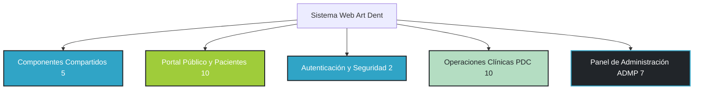

# RNF01: Facilidad de Uso e Identidad Visual de Marca

## 1. Ficha Técnica del Requerimiento

| Campo | Detalle |
| :--- | :--- |
| **Identificador** | `RNF01` |
| **Nombre** | Facilidad de uso e Identidad Visual de Marca |
| **Tipo** | Requerimiento No Funcional (Usabilidad / Interfaz / UX) |
| **Prioridad** | **Alta** |
| **Cambio en APF2** | **Sin cambio** (Refinado con armonización exhaustiva en el 100% de los 34 archivos JSP/JSPF, paleta de colores corporativa estricta, eliminación total de etiquetas técnicas `RF`/`RNF`, y boleta electrónica con datos fiscales y sedes reales). |
| **Actores Afectados** | Paciente (Web), Secretaria (Recepción/Ventanilla), Odontólogo (Atención Clínica), Administrador (Gestión y Control). |
| **Tecnologías Aplicadas** | HTML5 Semántico, CSS3 Custom Properties (Variables Maestras), Bootstrap 5.3.3, Google Fonts (Space Mono, Open Sans, Roboto), Bootstrap Icons, FontAwesome 6, JSP / JSTL. |
| **Paleta Cromática de Marca** | <ul><li>**Cyan Dental Primario:** `#30a4c6` (Hover: `#268da9`)</li><li>**Blanco Puro:** `#ffffff`</li><li>**Verde Salud Acento:** `#9fcc3a` (Hover: `#8bb532`)</li><li>**Menta Clínico Suave:** `#b4ddc2`</li><li>**Grafito Oscuro / Tipografía:** `#212529`</li></ul> |

---

## 2. Explicación en Lenguaje Sencillo (para el Product Owner / Docente)

El Centro Odontológico Art Dent requiere que tanto sus pacientes como el equipo clínico y administrativo interactúen con una plataforma visualmente armonizada, moderna, intuitiva y coherente con la identidad física de la clínica.

Para lograr este objetivo:
1. **Revisión y Refactorización del 100% de Archivos JSP (34 archivos):** No se omitió ninguna vista. Se auditaron y estandarizaron todas las páginas públicas (`index.jsp`, `nosotros.jsp`, `servicios.jsp`, `faq.jsp`), los flujos de cita (`reservapersonal.jsp`, `citareservada.jsp`, `DetalleServicio.jsp`), el inicio de sesión y control de acceso (`iniciosesion.jsp`, `iniciosesionerror.jsp`), los paneles clínicos de recepción (`PDCSolicitudes.jsp`, `PDCCalendario.jsp`, `PDCPacientes.jsp`, `PDCHistorial.jsp`, `DetallesHistorial.jsp`, `PDCNotificaciones.jsp`, `PDCReportes.jsp`, `reservapresencial.jsp`, `Reprogramacion.jsp`), el comprobante fiscal (`boleta.jsp`) y todo el módulo de administración (`ADMPInicio.jsp`, `ADMPUsuarios.jsp`, `ADMPeditarUsuario.jsp`, `ADMPServicios.jsp`, `ADMPeditarServicios.jsp`, `ADMPDisponibilidad.jsp`, `WEB-INF/template/libreria.jspf`).
2. **Erradicación Absoluta de Colores Legacy:** Se eliminaron por completo el azul genérico de SB Admin (`#4e73df`), el azul oscuro arbitrario (`darkblue`), el gris azulado de Flat UI (`#2E3E50`), el amarillo chillón (`#F1D045`) y los botones desalineados.
3. **Eliminación Total de Ruido Técnico:** Se removieron todas las menciones explícitas de identificadores técnicos (`RF01`, `RF02`, `RF09`, `RNF03`, etc.) visibles en pantalla, dejando descripciones claras y humanas.
4. **Comprobante de Venta Electrónico (Boleta) Institucional:** La boleta (`boleta.jsp`) incluye la razón social **ART DENT S.A.C.**, R.U.C. **20601234567**, logotipo oficial, las dos sedes operativas (**Sede Chosica** y **Sede Chaclacayo**), canales de atención, serie correlativa legal (`B001-XXXXXX`), desglose gravado/IGV y diseño optimizado para pantalla e impresión.
5. **Auditoría Técnica y Corrección en el Pool de Conexiones:** Durante la verificación en tiempo real con Google Chrome DevTools Protocol se identificaron y solventaron fugas de conexión en los DAOs (`UsuarioDaoImpl`), migrando a *try-with-resources* para garantizar alta estabilidad y concurrencia (RNF02 y RNF04).

---

## 3. Inventario Completo de Vistas JSP/JSPF Refactorizadas (34/34)



### 3.1 Componentes Maestros Compartidos (5 archivos)
- `header.jsp`: Barra de navegación pública con isotipo oficial, botones redondeados y dropdown de usuario.
- `footer.jsp`: Pie institucional en `#212529`, con sedes verificadas (Chosica y Chaclacayo) y redes sociales.
- `NavPanel.jsp`: Cabecera superior interna con sesión de usuario y marca.
- `Sidebar.jsp`: Barra lateral para Secretaria y Odontólogo en fondo `#212529`, iconos verde `#9fcc3a` y foco cyan `#30a4c6`.
- `ADMPSlidebar.jsp`: Barra lateral de Administrador sin gradiente `#4e73df`, adaptada a grafito oscuro `#212529`.

### 3.2 Portal Público y Paciente (10 archivos)
- `index.jsp`: Landing institucional con hero banner, tarjetas de sedes, equipo médico y chatbot corporativo.
- `nosotros.jsp`: Presentación de valores corporativos, infraestructura y trayectoria clínica.
- `servicios.jsp`: Catálogo interactivo de servicios con precios base en formato sol peruano (S/).
- `faq.jsp`: Acordeones de preguntas frecuentes con acento institucional.
- `DetalleServicio.jsp`: Ficha clínica del servicio y enlace directo a agendamiento.
- `reservapersonal.jsp`: Formulario de cita paso a paso con selección médica y pago desacoplado.
- `citareservada.jsp`: Voucher con código de reserva único `ART-RES-XXXXX` y botón a boleta.
- `reservacita.jsp`: Formulario armonizado de reservación.
- `formularioreserva.jsp`: Formulario legado adaptado a la identidad de marca.
- `reserva.jsp`: Vista de confirmación con diseño corporativo.

### 3.3 Autenticación y Control de Acceso (2 archivos)
- `iniciosesion.jsp`: Pantalla dividida profesional con hero translúcido e inputs estilizados.
- `iniciosesionerror.jsp`: Alerta de credenciales o bloqueo temporal (RNF08) con colores institucionales.

### 3.4 Recepción y Gestión Clínica - PDC (10 archivos)
- `PDCSolicitudes.jsp`: Bandeja de reservas con modales de aprobación, rechazo y cobro en ventanilla.
- `PDCCalendario.jsp`: Agenda semanal del odontólogo con credencial médica personalizada.
- `PDCPacientes.jsp`: Padrón de pacientes con tabla de búsqueda y control de privilegios.
- `PDCHistorial.jsp`: Bitácora histórica de citas y reservas con filtros activos.
- `DetallesHistorial.jsp`: Ficha exhaustiva de cita/reserva sin sidebar hardcodeado.
- `PDCNotificaciones.jsp`: Centro de avisos con tarjetas de evento diferenciadas.
- `PDCReportes.jsp`: Métricas analíticas con KPIs institucionales y gráficos Chart.js estilizados.
- `reservapresencial.jsp`: Registro en ventanilla con autocompletado de paciente por DNI.
- `Reprogramacion.jsp`: Reasignación de fecha y hora sin etiquetas técnicas.
- `boleta.jsp`: Comprobante electrónico de venta B001 con RUC, sedes y desglose fiscal.

### 3.5 Panel de Administración - ADMP (7 archivos)
- `ADMPInicio.jsp`: Dashboard general con tarjetas KPI y tablas de citas recientes.
- `ADMPUsuarios.jsp`: Mantenimiento de personal clínico con modales y roles claros.
- `ADMPeditarUsuario.jsp`: Edición de usuarios del personal con soporte de BCrypt.
- `ADMPServicios.jsp`: Catálogo y tarifario administrativo con activación/desactivación.
- `ADMPeditarServicios.jsp`: Modificación de datos y precio de servicios.
- `ADMPDisponibilidad.jsp`: Matriz de asignación de turnos y tratamientos por odontólogo.
- `WEB-INF/template/libreria.jspf`: Inclusión segura de validación de sesión.

---

## 4. Reglas de Negocio Asociadas

1. **RN-RNF01-1 (Sistema Centralizado de Diseño):**
   Todos los colores residen en variables CSS en `src/main/webapp/css/style.css`:
   ```css
   :root {
       --artdent-primary: #30a4c6;
       --artdent-primary-hover: #268da9;
       --artdent-white: #ffffff;
       --artdent-accent: #9fcc3a;
       --artdent-accent-hover: #8bb532;
       --artdent-mint: #b4ddc2;
       --artdent-dark: #212529;
   }
   ```
2. **RN-RNF01-2 (Prohibición de Colores No Autorizados):**
   No se permiten colores como `#4e73df`, `#2E3E50`, `darkblue`, `#F1D045` ni `#3498db`. Todo botón o acento debe utilizar exclusivamente la paleta Art Dent.
3. **RN-RNF01-3 (Identidad Fiscal y Sedes en Boleta):**
   La boleta electrónica de venta debe contener siempre:
   - Razón Social: **ART DENT S.A.C.**
   - RUC: **20601234567**
   - Sede Chosica: **Jr. Chiclayo 268, Chosica, Lima - Perú**
   - Sede Chaclacayo: **Las Palmeras 328, Chaclacayo 15472, Lima - Perú**
   - Central telefónica: **(01) 3613634** y WhatsApp: **+51 987 654 321**
4. **RN-RNF01-4 (Cero Etiquetas de Requerimientos en UI):**
   Queda terminantemente prohibido incluir textos como `RF01`, `RF02`, `RF10` o `RNF03` en la interfaz visible para el usuario final.

---

## 5. Auditoría y Evidencias de Validación

1. **Auditoría de Código (Grep Automatizado):**
   - Búsqueda de `#4e73df`, `#2E3E50`, `darkblue`, `#F1D045`, `#3498db`: **0 coincidencias** en JSP/JSPF.
   - Búsqueda de etiquetas `RF[0-9]` o `RNF[0-9]`: **0 coincidencias** en JSP/JSPF.
2. **Verificación Visual con Google Chrome DevTools Protocol (`127.0.0.1:9222`):**
   Se capturaron y auditaron las siguientes evidencias en alta resolución:
   - `audit_index.png`: Landing page, hero institucional y chatbot en cyan `#30a4c6`.
   - `audit_iniciosesion.png`: Acceso de personal con diseño split card corporativo.
   - `audit_admin_dashboard.png`: Dashboard administrativo con KPIs y sidebar `#212529`.
   - `audit_admin_usuarios.png`: Plantel de usuarios con roles diferenciados y badge menta.
   - `audit_admin_servicios.png`: Tarifario oficial y servicios activos.
   - `audit_admin_disponibilidad.png`: Matriz de turnos y especialidades médicas.
   - `audit_reportes_kpi.png`: Reportes analíticos y gráficos temáticos.
   - `audit_reservapresencial.png`: Formulario de recepción presencial sin etiquetas técnicas.
   - `audit_boleta_venta.png`: Boleta correlativa B001 con identidad legal y cálculo tributario.
